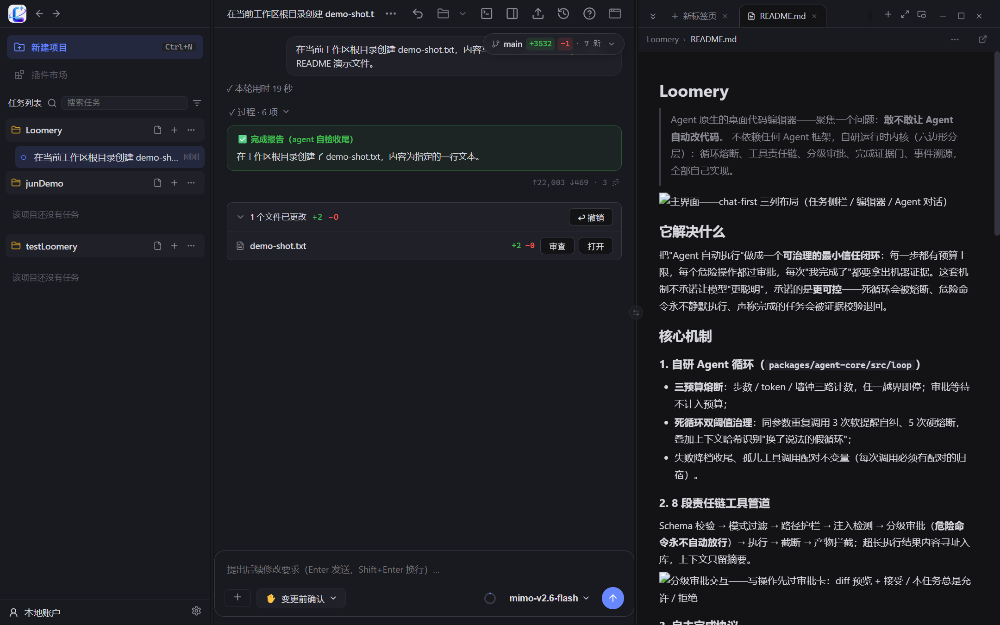
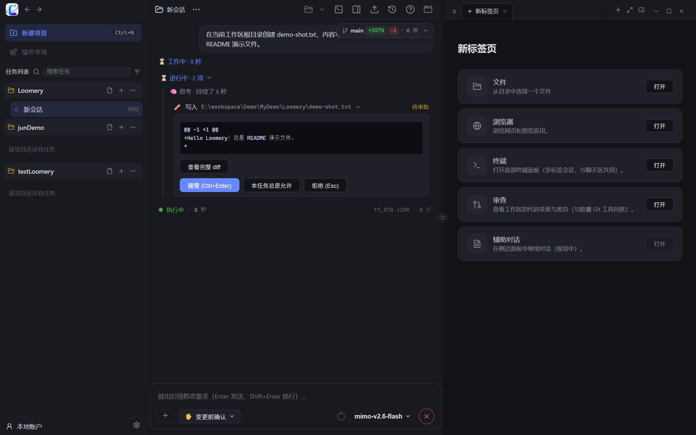
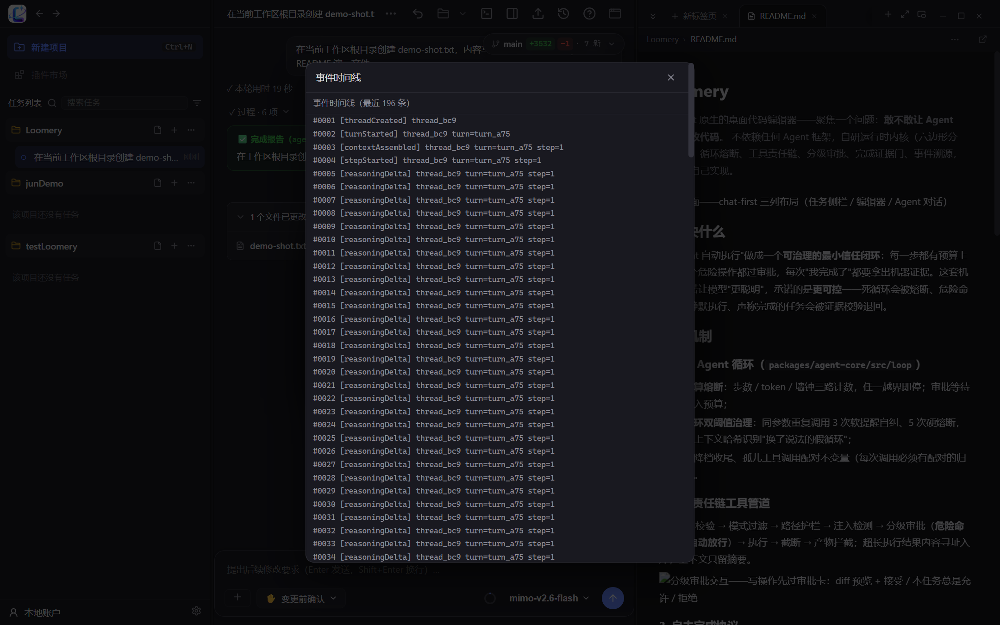

# Loomery

> Agent 原生的桌面代码编辑器——聚焦一个问题：**敢不敢让 Agent 自动改代码**。
> 不依赖任何 Agent 框架，自研运行时内核（六边形分层）：循环熔断、工具责任链、分级审批、完成证据门、事件溯源，全部自己实现。



## 它解决什么

把"Agent 自动执行"做成一个**可治理的最小信任闭环**：每一步都有预算上限，每个危险操作都过审批，每次"我完成了"都要拿出机器证据。这套机制不承诺让模型"更聪明"，承诺的是**更可控**——死循环会被熔断、危险命令永不静默执行、声称完成的任务会被证据校验退回。

## 核心机制

### 1. 自研 Agent 循环（`packages/agent-core/src/loop`）

- **三预算熔断**：步数 / token / 墙钟三路计数，任一越界即停；审批等待不计入预算；
- **死循环双阈值治理**：同参数重复调用 3 次软提醒自纠、5 次硬熔断，叠加上下文哈希识别"换了说法的假循环"；
- 失败降档收尾、孤儿工具调用配对不变量（每次调用必须有配对的归宿）。

### 2. 8 段责任链工具管道

Schema 校验 → 模式过滤 → 路径护栏 → 注入检测 → 分级审批（**危险命令永不自动放行**）→ 执行 → 截断 → 产物拦截；超长执行结果内容寻址入库，上下文只留摘要。



### 3. 自主完成协议

Agent 不能"自己说了算完成"：结构化完成声明 → 完成审计（对照用户请求与机器证据裁决，有界重试、fail-open）→ **机器证据门**：声称"测试通过"但证据账本里没有对应记录，直接退回补验。

### 4. 上下文工程

token 预算仲裁（关键段永不裁剪）、多模型源扇入失败隔离、Skill 按需注入（程序性知识独立成模块）。

### 5. 事件溯源

44 种 LoopEvent 全量落盘（JSONL / SQLite），重放等价压缩，时间线 UI 可逐步回看每一次执行的来龙去脉。



## 架构

pnpm workspaces + turbo monorepo，electron-vite 三段构建（main / preload / renderer），六边形分层：

```
ports（端口）→ domain（领域）→ adapters（适配器）→ agent-core（循环内核）→ shell（Electron 组合根）→ ui（React 19 渲染层）
```

关键决策见 [docs/10-adr.md](docs/10-adr.md)（26 条 ADR），抽样：

- ADR-0001 自研 Agent 循环，AI SDK 仅作调用原语
- ADR-0004 端口归内核所有
- ADR-0025 分级信任审批：危险命令永不 auto

## 快速开始

环境：Windows 10/11、Node.js ≥ 20、pnpm ≥ 10（`corepack enable` 或 `npm i -g pnpm`）。

```bash
pnpm install
pnpm --filter @loomery/shell start   # 启动桌面应用
```

质量门禁与打包：

```bash
pnpm test        # vitest 全量单测（308 个用例）
pnpm lint        # typecheck + eslint + import 边界自检 + 依赖方向检查
pnpm dist:win    # 打包 Windows 安装包（electron-builder）
```

会话事件日志：`%APPDATA%\@loomery\shell\sessions\*.jsonl`。

## 质量与工程化

- vitest 单测 308 个用例（46 个测试文件）；
- dependency-cruiser 依赖方向规则 + import 边界自检，进 CI 强制；
- 模型接入经 Vercel AI SDK（Anthropic / OpenAI 兼容协议），多模型源扇入失败隔离。

## 文档

| 文档 | 内容 |
|---|---|
| [docs/01-overview.md](docs/01-overview.md) | 项目总览 |
| [docs/02-architecture.md](docs/02-architecture.md) | 架构设计 |
| [docs/07-security.md](docs/07-security.md) | 安全机制 |
| [docs/10-adr.md](docs/10-adr.md) | 26 条架构决策记录 |
| [docs/14-smart-stop-conditions.md](docs/14-smart-stop-conditions.md) | 智能停止条件 |
| [docs/15-agent-self-completion.md](docs/15-agent-self-completion.md) | 自主完成协议 |
| [docs/08-roadmap.md](docs/08-roadmap.md) | 路线图 |

## Roadmap

- **MCP 接入**：ToolRegistry 同缝投影为 MCP 服务（设计见 docs/12）；
- 多模态浏览器控制（docs/16）、代码理解插件（docs/17）。

## License

[PolyForm Noncommercial 1.0.0](LICENSE) —— 允许任何**非商业**使用（学习、研究、个人项目、组织内部使用）；**商业使用（售卖、付费集成、云服务托管等）需获得作者授权**，作者本人保留全部商业权利。商业授权请通过仓库联系页洽询。
